<div align="center">

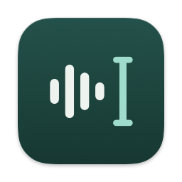

# Mostik

**Free, open-source dictation for Mac that gets your words right.**

Hold the right ⌥, speak, let go: the text lands at your cursor, in any app.
Recognition runs on your Mac, Mostik learns your names and terms, transcribes your calls,
and lets you set how the text comes out in each app.

[](https://github.com/tonyprots/mostik/releases/latest)
[](https://github.com/tonyprots/mostik/releases)
[](#requirements)
[](#requirements)
[](PRIVACY.md)
[](LICENSE)
[](https://github.com/tonyprots/mostik/actions/workflows/ci.yml)

<a href="https://github.com/tonyprots/mostik/releases/download/v0.1.0/mostik-promo.mp4">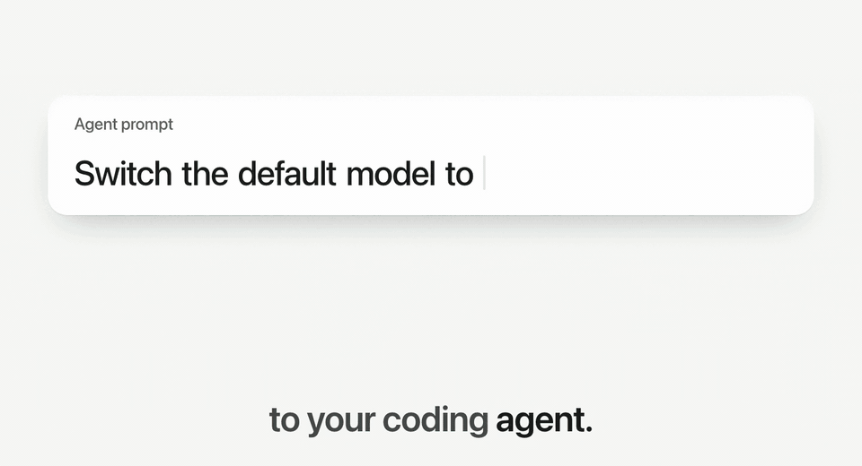</a>

<sub>A few seconds from the 1:03 film. Watch the whole thing with sound: <a href="https://github.com/tonyprots/mostik/releases/download/v0.1.0/mostik-promo.mp4">MP4, 16:9</a>.</sub>

**[Download for Mac](https://github.com/tonyprots/mostik/releases/latest)** · [Install](#install) · [Privacy](#privacy) · [FAQ](#faq) · [Русская версия](README.ru.md)

</div>

---

## Why Mostik

Typing is slow, and voice is faster. But ordinary dictation trips on the words that matter most: a colleague's
name, a project, a term from your code. You end up fixing them by hand.

Mostik is dictation for macOS built to get those words right. A second model checks the first one and marks the
words they disagree on instead of guessing silently. A glossary learns your names, projects and terms, and, for developers, the
identifiers of the repository you have open. The same app records your calls, with you and the other side on
separate tracks, and gives you a transcript with speakers. Styles, translation and voice commands let you set it up
your way. Recognition runs on the Mac: your audio never leaves it.

## Features

### Dictation that gets it right

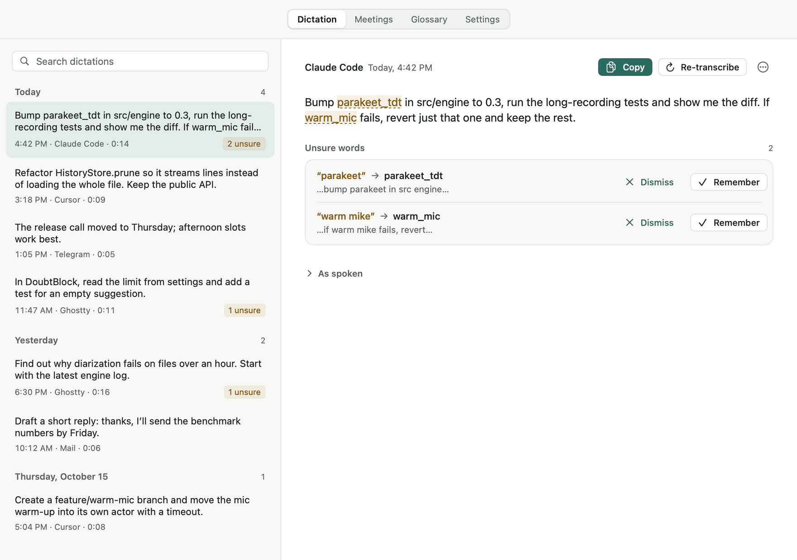

- **Recognised while you talk.** Mostik transcribes your speech in short windows as you go, so the text is ready the
  moment you let go of the key.
- **A second model checks the first.** Whisper Turbo, running in its own process, rechecks what the main model
  heard. Where the two disagree, the word is marked in the history: **Remember** fixes it and adds it to your
  glossary, **Dismiss** stops Mostik from suggesting that pair again.
- **Speech rules.** Say "new paragraph", "new line" or "scratch that", and Mostik breaks the line or removes the
  last sentence. These work even with polishing off. "First, second" can become a list and spoken numbers digits,
  if you turn that on.
- **Russian and English.** GigaAM v3 recognises Russian, Parakeet TDT v3 recognises English. Mostik can pick the
  language from the first seconds of speech, among the languages you choose (off by default).

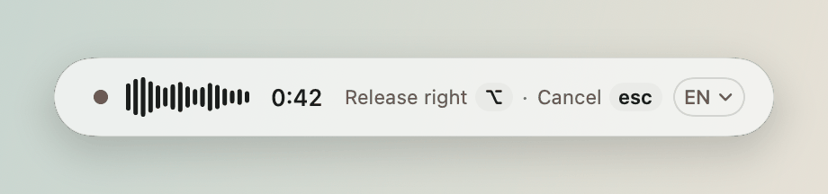

**Text goes where your cursor is.** Hold the right ⌥ and talk, or press ⌥Space to start and stop hands-free.
Mostik remembers the field you started in: if the focus moved elsewhere, the text waits in the clipboard instead of
landing in the wrong window. Esc cancels at any stage, and in the first 3 seconds after a paste it restores the
field. ⌃⌘Z undoes the last paste, ⌃⌘R swaps in the raw transcript. Nothing is typed into a password field.

### It learns your words

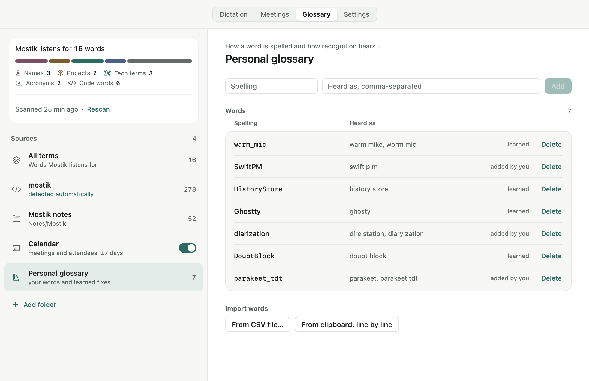

- **Personal glossary.** Each entry has two columns, "how it is spelled" and "how recognition hears it".
  Replacement works on whole words, and the longer rule wins.
- **Names and projects** come from your calendar (meetings and attendees) and from folders of notes you add.
- **Terms from your code** (developer option, off by default). Turn on “Terms from code” in Settings, and Mostik
  takes the open repository's identifiers, README headings and dependencies, so `parakeet_tdt` comes out spelled as
  in the code.
- **It learns from your edits.** For a minute after pasting, Mostik compares the field with what it typed (password
  fields are never read). Correct the same word twice in a week, and it offers to remember it. Only what you confirm
  goes into the glossary, and learning can be turned off.
- **Import** your words from Handy, Wispr Flow, a CSV file or the clipboard, with a preview of what is new.

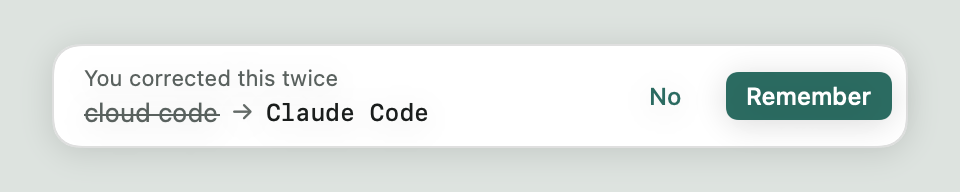

### Meetings, transcribed

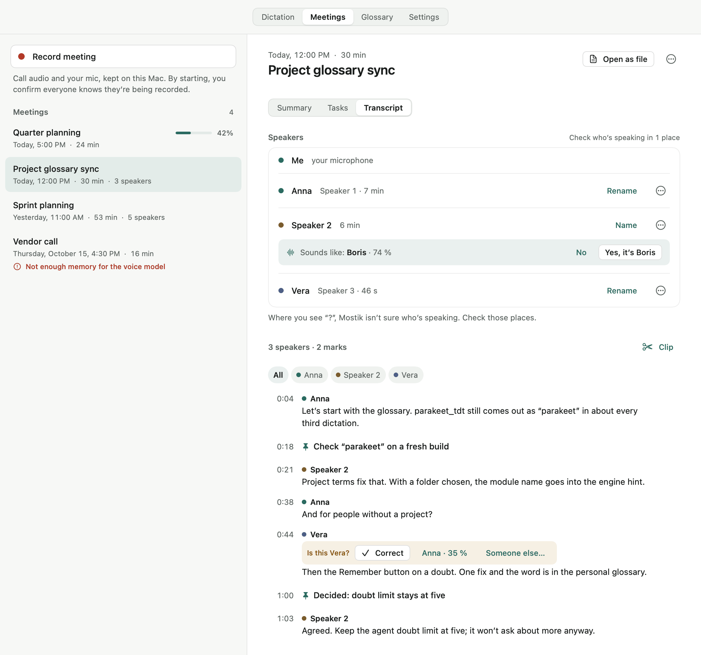

- **Two tracks.** Your microphone and the call audio are recorded separately. Works with Zoom, Google Meet, Yandex
  Telemost and any other app that plays sound. Mostik does not join the call as a bot.
- **A transcript with speakers.** Name them in place; voice memory can suggest names next time (off by default,
  behind a consent screen).
- **Marks and a live draft** during the call, a "text only" mode that discards the audio, and a meeting folder in an
  open format: `meeting.md`, `transcript.json`, `notes.md`.
- **Summaries that fit the meeting:** templates for a stand-up, a 1:1, a retro and a client call, plus formal minutes,
  tasks with owners and follow-up drafts. They are made by the local model or by Claude with your consent. Nothing is
  sent or created on its own.
- **A brief before the next call.** With a calendar connected, Mostik writes a Markdown file to `briefs/` 10 minutes
  before a meeting: what was agreed last time and who promised what. Your agent can read it through MCP.

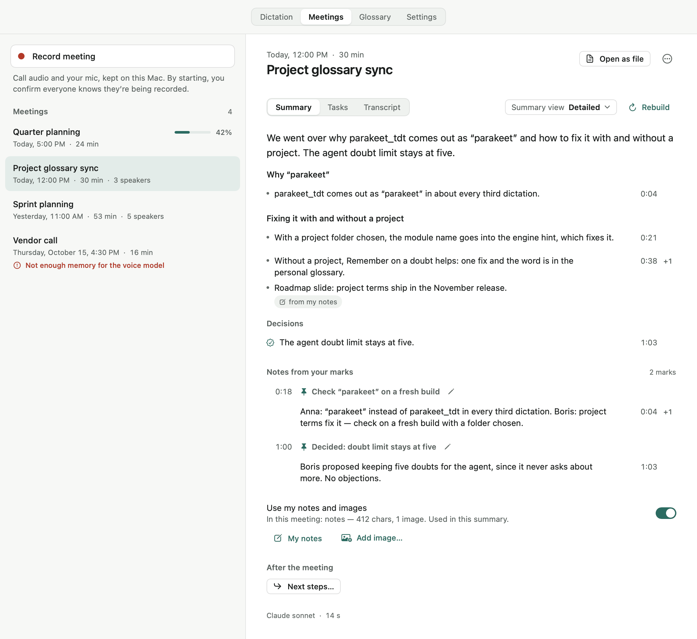

### Make it yours

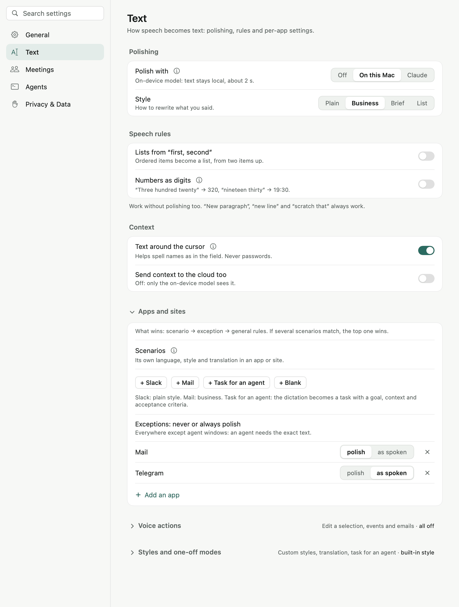

- **A style per app.** Plain, Business, Brief or List: brief in Slack, business-like in Mail. Scenarios set the
  language, style and translation for an app or a site.
- **Polish on your terms:** a local model (Gemma 4 E2B on MLX) that keeps text on the Mac, or Claude through your own
  `claude -p`, only after you agree.
- **Translate** what you say into English with one shortcut.
- **Voice commands** turn a sentence into a calendar event, a reminder or an email draft (enable in Settings).
- **A task for your agent:** the dictation becomes a task with a goal, context and acceptance criteria.

<br clear="right">

### For your coding agent

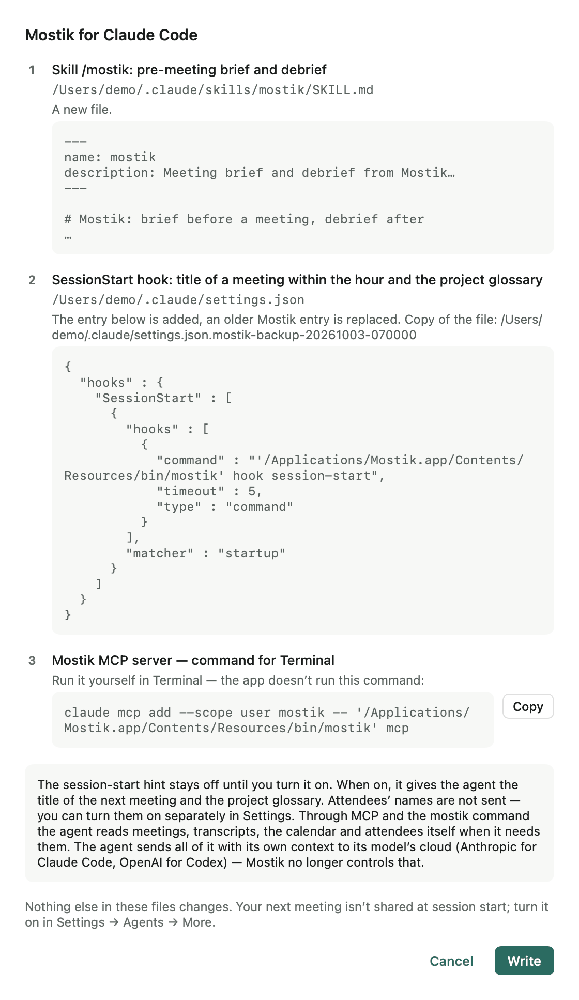

- **CLI.** `mostik history`, `doubts`, `meetings`, `search`, `glossary`, `calendar`: every answer is one JSON
  envelope, and errors carry the command to run next.
- **MCP server.** `mostik mcp` gives an agent your meetings, open action items, briefs, the glossary and recent unsure
  words. Agents can add notes to a meeting and change nothing else.
- **Skill and hook** for Claude Code and Codex: a pre-meeting brief, a debrief, and the current project's glossary
  at session start. The install sheet shows every file and every line before it writes them.
- **tmux.** Dictation can go straight into the pane where your agent runs, and "send" at the end presses Enter.

Meetings marked sensitive are invisible to agents.

<br clear="right">

## Install

**One command** in Terminal:

```bash
curl -fsSL https://tonyprots.github.io/mostik/install.sh | bash
```

The script downloads the latest `.dmg` from GitHub Releases, checks that the app is signed by the pinned
"Mostik Release" certificate, and only then copies Mostik to Applications and opens it. If the signature does not match, it
installs nothing. Because `curl` does not mark the file as downloaded from the internet, macOS opens the app without
the Gatekeeper prompt. The script uses only tools that ship with macOS: [scripts/install.sh](scripts/install.sh).

If you work with a coding agent, tell Claude Code or Codex: *Install Mostik: `curl -fsSL https://tonyprots.github.io/mostik/install.sh | bash`*.

**Or install the `.dmg` by hand.** The first launch needs one extra step:

> [!IMPORTANT]
> On first open macOS shows **"Mostik" Not Opened** with two buttons, **Move to Trash** and **Done**.
> Click **Done**, not Move to Trash. Then:
>
> 1. Download the `.dmg` from [GitHub Releases](https://github.com/tonyprots/mostik/releases/latest) and drag Mostik
>    to Applications first.
> 2. Open Mostik from Applications. In the "Not Opened" window, click **Done**.
> 3. Open **System Settings → Privacy & Security** and scroll down to **Security**. Next to
>    "Mostik was blocked to protect your Mac", click **Open Anyway**.
> 4. Confirm **Open Anyway** and enter your password or use Touch ID.
>
> You do this once. Mostik is signed with the project's own certificate rather than through Apple, so macOS asks for
> confirmation the first time. Updates are signed with the same certificate and install without this window.
> The Open Anyway button stays in Privacy & Security for about an hour after the blocked launch; if it is gone,
> open Mostik again and repeat step 3. On macOS 15 Sequoia and later, Control-clicking the app no longer does this.

On first launch Mostik shows which models it needs and how much they weigh, and downloads them from huggingface.co
when you click. After that it checks for updates once a day and installs a new version when you click **Install**.
Every release is signed with the same certificate, so macOS keeps your permissions. Details:
[docs/release.md](docs/release.md).

### Requirements

- A Mac with Apple silicon (M1 or later). Intel Macs are not supported: the models run on MLX and CoreML.
- macOS 14.2 or later, the first version that can record other apps' audio without screen recording.
- About 2.5 GB of disk for the required models. The English model (2.6 GB more) and the local polish model (3.6 GB)
  are optional.

The interface is in English and Russian and follows your system language.

### Permissions

Mostik asks only for what the features you turn on need.

| Permission | Why | When it is asked |
|---|---|---|
| Microphone | dictation and your side of a meeting | on first launch |
| Accessibility | to hear the dictation key, paste text and see where to paste it | on first launch |
| System audio recording | the other side of a meeting | on your first meeting recording |
| Screen recording | snapshots of the call window, if you turn them on | only if you turn them on; Mostik never requests it |
| Calendars | meeting titles and attendees from the macOS calendars you pick | only if you choose that source |

## Privacy

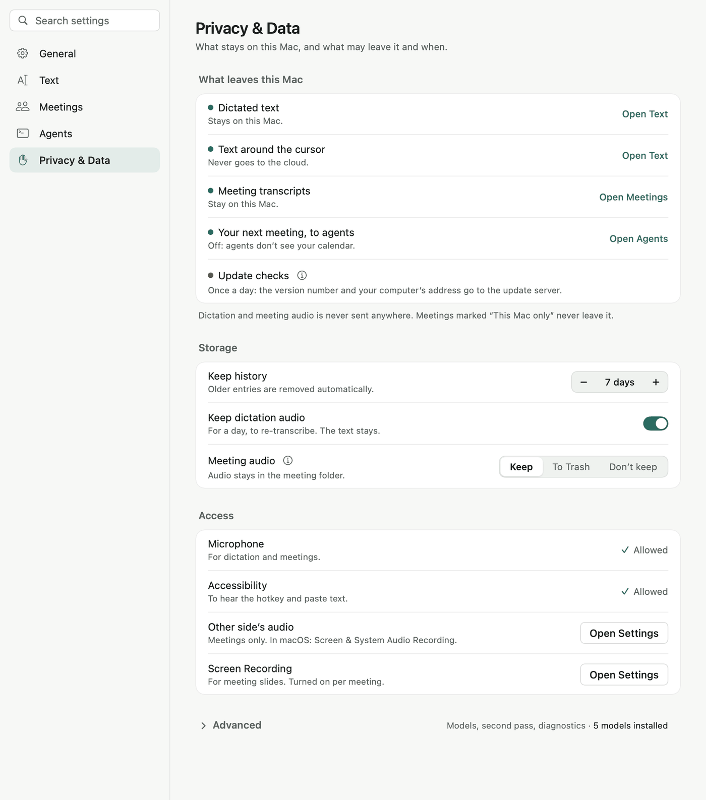

- **No account, no analytics, no telemetry**, no servers of our own.
- **Speech recognition runs on your Mac.** Dictation and meeting audio is never sent anywhere.
- **Text reaches the cloud only if you opt in**, and only through `claude -p`: Claude Code that you installed and
  signed in to yourself. With the local model, polish and summaries work offline.
- **What does go online:** the model download from Hugging Face when you click, a daily update check (your IP address
  and the Mostik version) to GitHub Pages, and your Google or Yandex calendar if you connect it.
- History is kept for 7 days by default; dictation audio for one day, so you can re-transcribe.

The full list of what is stored where and what leaves the Mac is in [PRIVACY.md](PRIVACY.md).

<br clear="right">

## How Mostik compares

Mostik is not the only good way to dictate on a Mac. Pick by what you need:

- **macOS Dictation** is built in and free, with nothing to install. It does not know the words of your codebase,
  and it does not record meetings.
- **Cloud dictation services** such as Wispr Flow are polished and work across devices, with recognition done on
  their servers. If you already use one, Mostik can import its dictionary.
- **Local Whisper-based apps** such as Handy keep recognition on the Mac, like Mostik. Mostik can import Handy's
  words too.

What Mostik focuses on: dictation that checks itself with a second model, a glossary that learns your names,
projects and code terms, meeting recording on separate tracks with speakers and summaries, settings per app, and a
CLI and MCP server so your agent can use all of it. It is free and MIT-licensed.

## FAQ

**Is it really free?**
Yes. Mostik is open source under the MIT licence, with no account and no paid tier.

**Why does macOS block the first launch?**
Releases are signed with the project's own certificate instead of a paid Apple Developer ID. A `.dmg` downloaded in a
browser therefore needs one confirmation in Privacy & Security; the one-command installer checks the signature itself
and skips that step. Updates are signed with the same certificate and install without asking again.

**Does it work on Intel Macs?**
No. The speech models run on MLX and CoreML, which need Apple silicon.

**Which languages can I dictate in?**
Russian and English. The Russian model is installed by default, the English one is an optional 2.6 GB download.

**Do I need Claude Code or an AI subscription?**
No. Recognition, the glossary and meeting transcripts work without any model in the cloud. Polish and meeting
summaries are optional and can run on a local model.

**Does Mostik join my calls?**
No. It records your microphone and the audio your Mac plays. By pressing Record you confirm that everyone knows
the meeting is recorded; Mostik can copy a notice for the meeting chat.

**Where is my data?**
In `~/Library/Application Support/Mostik/`: history, meetings, glossaries and settings as ordinary files. Logs are in
`~/Library/Logs/Mostik/` and never leave the Mac.

## Keyboard shortcuts

| Keys | Action |
|---|---|
| Right ⌥ (hold) | Dictate while you hold it |
| ⌥Space | Start or stop dictation without holding |
| Esc | Cancel at any stage; within 3 s after a paste, restore the field |
| ⌃⌘Y | Next polish style |
| ⌃⌘E | Translate the next dictation to English |
| ⌃⌘J | Make the next dictation a task for an agent |
| ⌃⌘K | Next dictation is a voice command: event, reminder or email draft (enable in Settings) |
| ⌃⌘V | Paste the last dictation again |
| ⌃⌘Z | Undo the last paste |
| ⌃⌘R | Replace the last paste with the raw transcript |
| ⌃⌘M | Start or stop a meeting recording |

## Build from source

You need a Mac with Apple silicon and macOS 14.2+, the Command Line Tools with Swift 6 (`xcode-select --install`;
Xcode is not required) and Python 3.14.

Command Line Tools 27 (Swift 6.4) without Xcode cannot run a plain `swift build` yet. Use `scripts/swift.sh` with the
same arguments (`scripts/swift.sh run MostikCoreTests`): it switches to the native build system and the macOS 26 SDK
only when it has to.

The engine runs in its own virtual environment:

```bash
python3.14 -m venv engine/.venv
```

```bash
engine/.venv/bin/pip install -r engine/requirements-apple.txt -r engine/requirements-test.txt
```

Run a debug build with that Python:

```bash
MOSTIK_PYTHON=engine/.venv/bin/python swift run Mostik
```

Build the `.app` with an embedded Python, as in a release ([docs/packaging.md](docs/packaging.md)):

```bash
scripts/bundle.sh
```

```bash
open dist/Mostik.app
```

This build is signed ad hoc, so macOS may ask for permissions again after a rebuild.

Tests:

```bash
swift run MostikCoreTests
```

```bash
cd engine && .venv/bin/python -m pytest tests -m "not slow"
```

Screens with demo data, as in this README:

```bash
swift run MostikSnapshots /tmp/mostik-snapshots --lang en
```

The app is Swift and SwiftUI; the engine is Python. How it fits together: [docs/architecture.md](docs/architecture.md).
The full feature reference is in Russian: [README.ru.md](README.ru.md).

## Contributing and security

Issues and pull requests are welcome. Report vulnerabilities privately as described in [SECURITY.md](SECURITY.md).
Changes are listed in [CHANGELOG.md](CHANGELOG.md).

## Author

Made by Anton Protsenko · [tonyprots.ru](https://tonyprots.ru). MIT licence, see [LICENSE](LICENSE).
