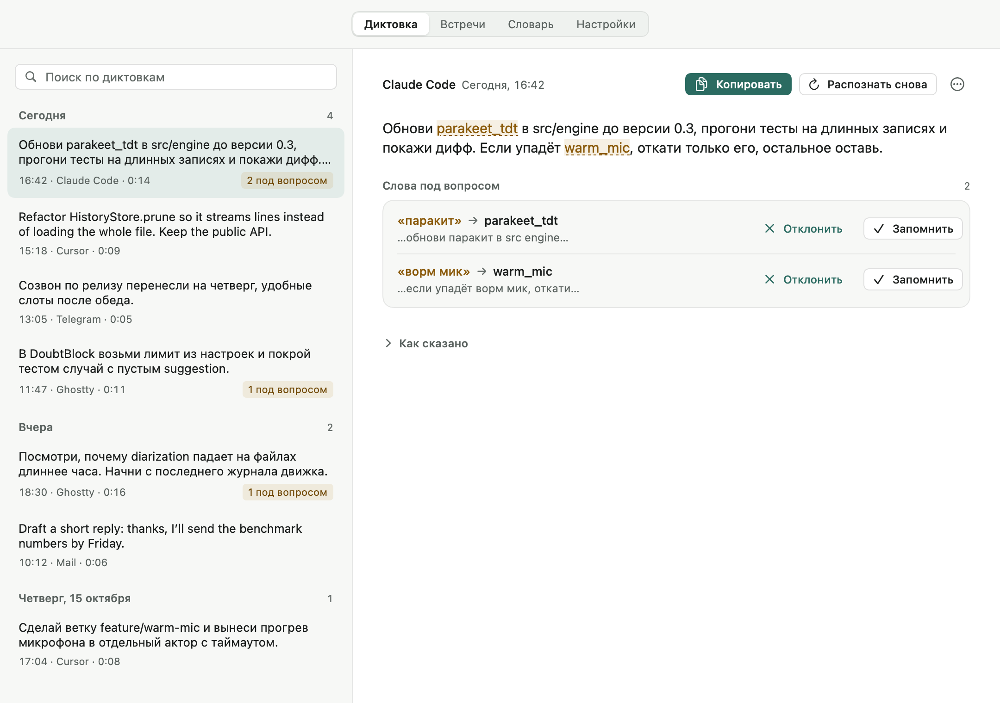

<div align="center">


# Mostik

**Бесплатная диктовка для Mac с открытым кодом, которая не путает ваши слова.**

Зажмите правый ⌥, надиктуйте, отпустите — текст встанет туда, где курсор, в любом приложении.
Речь распознаётся на самом Mac. Mostik запоминает ваши имена и термины, расшифровывает созвоны
и пишет в каждом приложении так, как вы настроили.

[](https://github.com/tonyprots/mostik/releases/latest)
[](https://github.com/tonyprots/mostik/releases)
[](#что-нужно)
[](#что-нужно)
[](PRIVACY.md)
[](LICENSE)

<a href="https://github.com/tonyprots/mostik/releases/download/v0.1.0/mostik-promo.mp4"></a>

<sub>Несколько секунд из ролика на 1:03, ролик целиком со звуком — <a href="https://github.com/tonyprots/mostik/releases/download/v0.1.0/mostik-promo.mp4">MP4, 16:9</a> (на английском).</sub>

**[Скачать для Mac](https://github.com/tonyprots/mostik/releases/latest)** · [Установка](#установка) · [Приватность](PRIVACY.md) · [English](README.md)

</div>

---

## Зачем

Печатать долго, голосом быстрее. Но обычная диктовка ошибается как раз в важных словах: в имени коллеги, названии проекта, термине из кода. Потом их правишь руками.

Mostik пишет такие слова правильно. Вторая модель перепроверяет первую и помечает слова, в которых они разошлись, вместо того чтобы молча угадывать. Словарь запоминает ваши имена, проекты и термины, а разработчикам — и идентификаторы открытого репозитория. Правила речи работают сразу: «новый абзац» начинает абзац, «зачеркни» убирает последнее предложение.

Созвоны Mostik записывает двумя дорожками: ваш микрофон отдельно, собеседники отдельно. После встречи получается расшифровка с говорящими, по желанию — сводка под тип встречи, а перед следующей встречей из календаря — бриф. Для каждого приложения можно задать свой стиль и перевод, а голосовые команды превращают фразу в событие календаря или черновик письма.

Распознавание работает на Mac, звук в сеть не уходит. Текст попадает в облако только с вашего согласия: для причёсывания и сводок через `claude -p` или `codex exec`. Подробно — в [PRIVACY.md](PRIVACY.md).



## Что нужно

- Mac на Apple silicon (M1 и новее). На Intel Mostik не работает: модели запускаются через MLX и CoreML.
- macOS 14.2 или новее: с этой версии можно записывать звук других приложений без записи экрана.
- Около 2,5 ГБ на диске под обязательные модели. Английская модель (ещё 2,6 ГБ) и локальная модель причёсывания (3,6 ГБ) ставятся по желанию.

## Установка

**Одной командой** в Терминале:

```bash
curl -fsSL https://tonyprots.github.io/mostik/install.sh | bash
```

Скрипт скачивает свежий `.dmg` из GitHub Releases, проверяет, что приложение подписано закреплённым сертификатом «Mostik Release», и только после этого кладёт Mostik в «Программы» и открывает его. Подпись не совпала — не ставит ничего. `curl` не помечает файл как скачанный из интернета, поэтому macOS открывает приложение без окна Gatekeeper. Скрипт обходится инструментами, которые есть в macOS: [scripts/install.sh](scripts/install.sh).

Если работаете с агентом, скажите Claude Code или Codex: *Install Mostik: `curl -fsSL https://tonyprots.github.io/mostik/install.sh | bash`*.

**Или вручную, через `.dmg`.** Первый запуск потребует одного лишнего шага:

> [!IMPORTANT]
> При первом открытии macOS покажет окно **«Файл „Mostik“ не был открыт»** с кнопками **«Переместить в Корзину»** и **«Готово»**.
> Нажмите **«Готово»**, не «В Корзину». Дальше:
>
> 1. Скачайте `.dmg` со страницы [GitHub Releases](https://github.com/tonyprots/mostik/releases/latest) и сначала перетащите Mostik в «Программы».
> 2. Откройте Mostik из «Программ». В окне «не был открыт» нажмите **«Готово»**.
> 3. Откройте «Системные настройки» → «Конфиденциальность и безопасность» и прокрутите до раздела «Безопасность». Рядом со строкой о том, что Mostik заблокирован, нажмите **«Всё равно открыть»**.
> 4. Подтвердите «Всё равно открыть» и введите пароль или приложите палец к Touch ID.
>
> Это нужно один раз: Mostik подписан собственным сертификатом проекта, а не через Apple, поэтому в первый раз macOS просит подтверждения. Обновления подписаны тем же сертификатом и ставятся без этого окна. Кнопка «Всё равно открыть» видна в настройках примерно час после попытки запуска; если её нет, откройте Mostik ещё раз и повторите шаг 3. На macOS 15 Sequoia и новее Control-клик по приложению этого уже не делает.

При первом запуске Mostik покажет, какие модели нужны и сколько они весят, и скачает их с huggingface.co по вашей кнопке. Дальше он обновляется сам: раз в день проверяет, есть ли новая версия, и ставит её, когда вы нажмёте «Установить». Обновление скачивает сам Mostik, поэтому macOS больше не спрашивает, а разрешения сохраняются: все версии подписаны одним сертификатом. Как это устроено — [docs/release.md](docs/release.md).

## Разрешения

Mostik просит только то, что нужно для включённых функций.

| Разрешение | Зачем | Когда спрашивается |
|---|---|---|
| Микрофон | записывать диктовку и ваш голос на встрече | при первом запуске |
| Универсальный доступ | слышать клавишу диктовки, вставлять текст в поле и читать, куда вставлять | при первом запуске |
| Запись системного звука | записывать голоса собеседников на встрече | при первой записи встречи |
| Запись экрана | снимать окно звонка, если вы включили кадры встречи | только если включите; Mostik сам не запрашивает |
| Календари | брать название и участников встречи из календарей macOS | только если выберете этот источник |

## Как устроено

- **Приложение** на Swift и SwiftUI: меню-бар, плашка записи внизу экрана, окно с историей, встречами, словарём и настройками.
- **Движок** на Python. Код распознавания взят из проекта transcriber того же автора, копия лежит в `engine/vendor_transcriber/` (источник и коммит — её `SOURCE.md`):
  - основная модель — GigaAM v3 для русского, Parakeet TDT v3 для английского;
  - проверяющая — Whisper Turbo MLX, она работает в отдельном процессе и сама текст не правит;
  - текст распознаётся окнами прямо во время речи, поэтому после отпускания клавиши остаётся досчитать только хвост.
- **Словари.** Личный учится на кнопке «Запомнить». Словарь проекта собирается из репозитория: идентификаторы, заголовки README, зависимости. Это режим для разработчиков, по умолчанию выключен: Настройки → Приватность и данные → Дополнительно → «Термины из кода».
  - У каждого слова две колонки: «Как пишется» и «Что модель пишет вместо». Замена идёт целыми словами, длинное правило побеждает.
  - «Запомнить написание…» есть у каждой диктовки, а после вставки со словами под вопросом — карточкой над плашкой.
  - Обучение на правках: минуту после вставки Mostik сверяет поле с тем, что вставил (поля паролей не читаются). Если одно слово поправлено дважды за неделю, он предложит его запомнить. В словарь попадает только подтверждённое; выключается в Настройках.
  - Перенос слов из Handy, Wispr Flow, CSV-файла или буфера построчно — с просмотром «найдено / уже есть / новых».
  - Язык диктовки можно определять автоматически: только из выбранных языков (по умолчанию — языки Mac), по первым секундам записи. Выключено по умолчанию.

Подробно — в [docs/architecture.md](docs/architecture.md), замеры — в [docs/bench.md](docs/bench.md).

## Чем Mostik отличается

Mostik — не единственная хорошая диктовка для Mac. Выбирайте по задаче:

- **Диктовка macOS** встроена и бесплатна, ставить ничего не нужно. Слов вашего кода она не знает и встречи не записывает.
- **Облачные сервисы диктовки**, например Wispr Flow, удобны и работают на разных устройствах, а речь распознают на своих серверах. Словарь из Wispr Flow Mostik умеет перенести.
- **Локальные приложения на Whisper**, например Handy, распознают речь на Mac, как и Mostik. Слова из Handy тоже переносятся.

Mostik делает упор на другое: диктовку, которую проверяет вторая модель, словарь, который запоминает ваши имена, проекты и термины из кода, запись встреч двумя дорожками с говорящими и сводками, настройки под каждое приложение, CLI и MCP-сервер для агента. Бесплатно, лицензия MIT.

## Вопросы

**Это правда бесплатно?** Да. Открытый код под MIT, без учётной записи и платного тарифа.

**Почему macOS не даёт открыть приложение в первый раз?** Выпуски подписаны собственным сертификатом проекта, а не платным Apple Developer ID. Поэтому `.dmg` из браузера нужно один раз подтвердить в «Конфиденциальности и безопасности». Установщик одной командой сам проверяет подпись, и этот шаг не нужен. Обновления подписаны тем же сертификатом и ставятся без вопросов.

**Работает ли на Intel?** Нет. Модели распознавания запускаются через MLX и CoreML, им нужен Apple silicon.

**На каких языках можно диктовать?** На русском и английском. Русская модель ставится сразу, английская — по желанию, ещё 2,6 ГБ.

**Нужен ли Claude Code или подписка на ИИ?** Нет. Распознавание, словарь и расшифровка встреч работают без облачных моделей. Причёсывание и сводки встреч — по желанию, их может делать локальная модель.

**Mostik подключается к звонку?** Нет. Он записывает ваш микрофон и звук, который играет Mac. Нажимая «Записать», вы подтверждаете, что участники знают о записи; текст предупреждения для чата Mostik скопирует сам.

**Где мои данные?** В `~/Library/Application Support/Mostik/`: история, встречи, словари и настройки — обычными файлами. Журналы лежат в `~/Library/Logs/Mostik/` и никуда не уходят.

## Сборка из исходников

Нужны Mac на Apple silicon с macOS 14.2+, Command Line Tools со Swift 6 (`xcode-select --install`; Xcode не нужен) и Python 3.14.

На Command Line Tools 27 (Swift 6.4) без Xcode обычный `swift build` пока не работает. Вызывайте `scripts/swift.sh` с теми же аргументами (`scripts/swift.sh run MostikCoreTests`): он включает старую систему сборки и SDK macOS 26 только там, где это нужно.

Движок для разработки — в своём venv:

```bash
python3.14 -m venv engine/.venv
```

```bash
engine/.venv/bin/pip install -r engine/requirements-apple.txt -r engine/requirements-test.txt
```

Запуск debug-сборки с этим Python:

```bash
MOSTIK_PYTHON=engine/.venv/bin/python swift run Mostik
```

Сборка `.app` со встроенным Python (как в выпуске; подробно — [docs/packaging.md](docs/packaging.md)):

```bash
scripts/bundle.sh
```

```bash
open dist/Mostik.app
```

Сборка подписана ad-hoc, поэтому после пересборки macOS может спросить разрешения заново.

## Сочетания клавиш

| Клавиши | Что делают |
|---|---|
| Правый ⌥ (удерживать) | Диктовка: говорите, пока держите |
| ⌥Space | Начать или закончить диктовку без удержания |
| Esc | Отменить на любом этапе: запись, расшифровку, вставку. В первые 3 секунды после вставки возвращает полю прежний текст |
| ⌃⌘Y | Следующий стиль причёсывания по кругу: встроенные, затем стили-файлы |
| ⌃⌘E | Следующую диктовку перевести на английский (ещё раз — отмена) |
| ⌃⌘J | Следующую диктовку оформить задачей агенту (ещё раз — отмена) |
| ⌃⌘K | Следующая диктовка — голосовая команда: событие, напоминание или письмо черновиком (ещё раз — отмена; включается в Настройках) |
| ⌃⌘V | Вставить последнюю диктовку ещё раз туда, где сейчас курсор |
| ⌃⌘Z | Откатить последнюю вставку |
| ⌃⌘R | Заменить последнюю вставку сырой расшифровкой, без словаря и правок |
| ⌃⌘M | Начать или остановить запись встречи (отключается в Настройках) |
| ⌘, | В окне Mostik: открыть Настройки |
| ⌘1…⌘3 | В окне Mostik: Диктовка, Встречи, Словарь |
| ⌘W, Esc | Закрыть окно; Esc закрывает листы и окна согласия |

Сочетания с ⌃⌘ не заняты ни macOS, ни стандартными меню приложений. Вариант с ⌃⌥ отпал: эти клавиши использует VoiceOver. Последние три действия есть и в меню Mostik.

Отменённая диктовка не пропадает: текст и аудио остаются в истории с пометкой «отменено». Откат срабатывает, только если поле с момента вставки не меняли: тот же элемент, тот же текст, каретка на месте. Если поле уже изменилось, Mostik его не трогает и кладёт исходник в буфер.

## Причёсывание: правила речи, контекст, сценарии

Настройки → «Причёсывание текста» и группы под ним.

- **Правила речи** работают и без причёсывания, прямо в движке. По умолчанию включены «новый абзац» и «новая строка» отдельной фразой, а также «зачеркни» в конце фразы: оно убирает предыдущее предложение. Галочкой включаются список из «во-первых, во-вторых» (только от двух пунктов) и числа цифрами («тремстам двадцати» → 320, «к девятнадцати тридцати» → 19:30).
- **Контекст.** Выделение и до 256 знаков вокруг курсора помогают модели написать имена и термины как в поле. Буфер обмена — только с галочкой. В облако (Claude) контекст уходит только с отдельной галочкой. Поля паролей, менеджеры паролей и банки не читаются.
- **Сценарии** по приложению или сайту: язык, «как сказано» или стиль, стиль-файл, перевод, Enter после вставки. Превью тона — на макетах Slack и письма.
- **Стили-файлы** — папка `<данные Mostik>/styles/<имя>/` с `prompt.md` и `dictionary.txt`; «Добавить пример» кладёт образец.
- **Вставка по ходу причёсывания** (только локальная модель, выключена по умолчанию): готовые предложения появляются в поле, пока модель пишет дальше.
- **Сообщение агенту посреди хода** (выключено по умолчанию). Пока Claude Code работает, надиктованное в его окно уходит в очередь, и агент получает его после очередного шага. Работает через хуки `UserPromptSubmit`, `PostToolUse` и `Stop` (`integrations/claude-code/hooks/mostik-queue.sh`). Ставятся они только кнопкой «Установить…», которая сначала показывает, что и куда запишется.

## Голосовые команды

Настройки → «Голосовые команды», по умолчанию выключено. ⌃⌘K, затем диктовка: «создай встречу завтра в три с Петей», «напомни через полчаса проверить сборку», «черновик письма Пете о переносе релиза». Над HUD появляется карточка «Открыть в Календаре» или «Открыть в Почте» и «Отмена».

- Mostik делает только черновики. Событие и напоминание открываются файлом `.ics`, их сохраняет Календарь после подтверждения. Письмо открывается в Почте без адреса и не отправляется. Контакты не ищутся: имя остаётся как сказано.
- Дату и время разбирают правила. Модель причёсывания (локальная или Claude, согласие то же) уточняет название и текст письма.
- Если команда не распознана или уверенность ниже порога (по умолчанию 60%), текст вставляется как обычная диктовка.

Протокол и правила — `docs/polish-contract.md`, замер — `docs/bench.md`.

## Как доставляется текст

- Mostik запоминает поле в начале записи. Если к моменту вставки фокус ушёл в другое приложение или поле, текст остаётся в буфере.
- В поле пароля текст не вставляется: он сохраняется только в истории.
- Если слева от каретки буква или знак препинания, на стыке появляется пробел.
- Вставка идёт через ⌘V, в Electron и Firefox тоже: прямая запись через Accessibility там дублирует текст. Временная запись в буфере помечена как transient и concealed, поэтому менеджеры буфера её не сохраняют. Прежнее содержимое буфера возвращается, только если после нас буфер никто не менял.
- После вставки Mostik дважды перечитывает поле. Если оно не изменилось, появляется карточка «Текст не вставлен, расшифровка сохранена», а текст остаётся в буфере. Результат проверки записывается в историю.
- Диктовки за последние сутки (до трёх) доступны в меню. Аудио сохраняется при любом сбое, так что расшифровку можно повторить.

## Встречи

Запись встречи — кнопка во вкладке «Встречи» или карточка «Записать / Нет», которая появляется, когда звонок держит микрофон 10 секунд. Папка встречи — открытый формат: `manifest.json`, `meeting.md` с YAML-шапкой (участники, задачи, решения), `transcript.json`, `notes.md`. Описание — [docs/meeting-folder.md](docs/meeting-folder.md).

- **Живучесть.** Если дорожка встала, Mostik перезапускает её новым сегментом. Встречу, брошенную при сбое, он дорасшифровывает при следующем запуске.
- **Календарь.** Ссылка на звонок, напоминание за минуту, повестка и заметка до встречи. Пункты повестки во время записи становятся пометками. Автоостановка после конца события выключена по умолчанию. Источник календаря выбирается в Настройках: Google, Яндекс (CalDAV) или отмеченные календари macOS, по умолчанию ни один ([docs/calendars.md](docs/calendars.md)); для остальных — команда, печатающая события в JSON ([docs/external-calendar.md](docs/external-calendar.md)).
- **Фрагмент.** Выделенные реплики сохраняются как `.m4a` и `.md` в `clips/` встречи.
- **Говорящие.** Метки «Собеседник N» можно назвать прямо в окне встречи. Если диаризация не уверена в метке (ниже 0,6), у реплики появляется плашка с вариантами. Голосовая память узнаёт собеседников по отпечатку голоса, а не по записи, и предлагает имя на подтверждение. Она выключена по умолчанию и включается только через экран согласия. Подробности — [docs/voice-memory.md](docs/voice-memory.md).
- **Только про вас.** Доля речи, самый длинный монолог и число вопросов. Других участников Mostik не оценивает.
- **Приватность.** Встречу с пометкой «чувствительная» не получают ни хук, ни агенты. Аудио после готовой сводки можно убирать в Корзину (выключено по умолчанию).
- **Команда после встречи.** Ваш скрипт получает путь к папке в `$1`. Выключено по умолчанию, вывод пишется в `~/Library/Logs/Mostik/meeting-hooks.log`.
- **Согласие при старте.** Нажать «Записать» значит подтвердить, что участники знают о записи. Кнопка «Текст предупреждения» копирует сообщение для чата встречи; свой текст задаётся в Настройках. У ближайшей встречи календаря есть «Черновик письма участникам»: письмо открывается в почте неотправленным, отправляете вы.
- **По ходу записи.** Черновые строки расшифровки каждые 15–25 секунд, их можно листать и копировать. Говорящие там — «Я» и «Собеседники», точная расшифровка появляется после остановки.
- **Только текст.** Переключается до записи и в пилюле. Звук отрезков «только текст» после расшифровки затирается тишиной. Если так прошла вся встреча, аудио уходит в Корзину.
- **Продолжить запись.** Остановленную встречу можно продолжить в той же папке, время идёт дальше. Расшифровка собирается заново, имена говорящих надо подтвердить ещё раз.
- **Ремонт говорящих.** Фильтр по говорящему над расшифровкой. В меню реплики: «Прослушать», «Эту реплику говорит…» и «Все реплики … — это…», когда диаризация разрезала одного человека на два голоса. Наведение на ссылку в сводке показывает реплику, нажатие ставит «Слушать с этого места».
- **Автостарт и шумоподавление.** Запись звонка может начинаться сама, когда приложение звонка держит микрофон 10 секунд, но только после принятого предупреждения о согласии (выключено по умолчанию). Шумо- и эхоподавление Apple для встречи — «Выкл», «С колонками» или «Всегда»; для диктовки — отдельный переключатель.

- **Вопросы и подсказки.** Mostik ловит вопросы в живой расшифровке: сначала правилами, а сомнительные проверяет локальной моделью, если она загружена. Журнал «отвечен / нет» ведётся в `questions.json`. Подсказки выключены по умолчанию. На вопрос собеседника они находят фрагмент в словаре, источниках и архиве встреч и показывают карточку со ссылкой, не чаще раза в 20 с.
- **Кадры окна звонка.** Выключено по умолчанию, согласие на каждую встречу. Окно звонка снимается при заметной смене картинки и сохраняется в `frames/`. В сводку идёт только распознанный текст. При чувствительной встрече и в режиме «только текст» кадры не снимаются. Разрешение «Запись экрана» выдаёте вы, Mostik его не запрашивает.

### Сводка встречи

После расшифровки модель делает сводку, заметки по пометкам и задачи с исполнителями. Модель — Claude через `claude -p`, Codex через `codex exec` или локальная, на это нужно отдельное согласие. Договор — [docs/polish-contract.md](docs/polish-contract.md).

- **Шаблон по типу встречи.** Стендап, 1:1, ретро, клиент или обычная встреча — тип берётся из события календаря, его можно сменить руками. Шаблоны — Markdown-файлы, свои кладутся в `templates/` папки Mostik. Прежняя сводка перед пересборкой сохраняется в `history/` встречи.
- **Разделы по темам.** Заголовки берутся из тем разговора, а не «Ключевые выводы». У стендапа и 1:1 разделы по людям. Решения идут отдельным блоком.
- **Протокол и другие виды.** «Протокол» с «СЛУШАЛИ / РЕШИЛИ» по повестке, «Для руководителя», «Только решения» и своя сводка, описанная словами. Виды лежат рядом и не затирают основную.
- **Свои записи и картинки.** Повестка, записи из `notes.md` и скриншоты идут в сводку отдельно от речи. Текст на картинках распознаётся на Mac, в модель уходят только подпись и этот текст.
- **Имя встречи.** «Встреча 14:32» без события в календаре получает имя по теме из сводки.
- **После встречи.** Рецепты (письмо-итог от вас, PRD, обратная связь, запросы на функции) и «Следующие шаги»: письмо открывается в Почте неотправленным черновиком, задачи копируются текстом для трекера, событие-продолжение сохраняется файлом `.ics`. Ничего не отправляется и не создаётся само. У чувствительных встреч рецептов и шагов нет.

### Архив встреч

Архив собирается локально, обычными файлами Markdown в папке данных Mostik, без векторного индекса. Читать его удобно агентом через MCP (ниже); отдельной вкладки в окне нет. Описание — [docs/meeting-archive.md](docs/meeting-archive.md).

- **Карточка встречи.** Решения, открытые вопросы, поручения, люди и цитаты, у каждого пункта ссылка `путь:строка` на расшифровку.
- **Бриф.** За 10 минут до встречи: на чём остановились, чьи обещания открыты, о чём договорились. Срок вроде «до пятницы» превращается в дату.
- **Люди, темы, сводки.** Карточка каждого собеседника в `people/`, поиск по своим словам-триггерам, сводка за неделю по расписанию (по умолчанию пятница, 17:00) и сводка по серии встреч.
- Чувствительные встречи в архив не попадают.

## Голос и агенты

Всё в Настройках → «Голос и агенты». Кроме ссылок на файлы, по умолчанию выключено.

- **Вставка в панель tmux.** В терминале с tmux текст уходит в панель с агентом одной вставкой (bracketed paste): буфер обмена не трогается, перенос строки не отправит сообщение раньше времени. Панель — активная в показанной сессии или закреплённая в Настройках. Без tmux опция недоступна.
- **Обращение по имени.** «Фронтенду: поправь тест» отправит текст в сессию tmux `frontend`, даже если впереди другая вкладка. Имя ищется среди сессий, окон и папок проектов с агентом.
- **Отправка голосом.** Если последнее слово — «отправь» или «send», Mostik его уберёт и после вставки нажмёт Enter. «Отправь письмо Маше» так не сработает.
- **Ссылки на файлы.** В Claude Code, Codex и Cursor «в auth check» станет `@src/authCheck.ts`, если в проекте ровно один такой файл.
- **Озвучка агента.** Когда Claude Code закончил ход или ждёт разрешения, звучит сигнал и голос: «Проекту Mostik нужно разрешение». Работает через хуки Claude Code. Их ставит кнопка «Установить…», и перед записью она показывает, что и куда добавится. Скрипт-приёмник — `integrations/claude-code/hooks/mostik-notify.sh`.
- **Голос озвучки.** Русский и английский голоса выбираются из уже установленных в macOS, улучшенные и Premium показаны первыми. Удалённый голос заменяется лучшим из оставшихся.

## Для агентов: CLI, MCP, скилл

Агенты читают историю диктовок, встречи и словарь через команду `mostik`. Она лежит внутри приложения: `Mostik.app/Contents/Resources/bin/mostik`, в репозитории — `bin/mostik`. Чтобы вызывать её из терминала, добавьте симлинк. Команду с нужным путём показывает Настройки → «Агенты: CLI, MCP, скилл»:

```bash
mkdir -p ~/.local/bin && ln -sf /Applications/Mostik.app/Contents/Resources/bin/mostik ~/.local/bin/mostik
```

- **CLI.** `mostik spec` перечисляет команды: `history`, `doubts`, `meetings list/get/actions/note`, `search`, `glossary`, `calendar`, `context`. Ответ всегда в одном JSON-конверте: `{"ok": true, "data": …, "meta": {"schemaVersion": 1}}`. Ошибка выглядит как `{"ok": false, "error": {"code", "message", "fix"}}`, где `fix` — команда, которую стоит выполнить следующей.
- **MCP.** `mostik mcp` — сервер по stdio с инструментами `search_meetings`, `get_meeting`, `open_actions`, `add_note`, `get_glossary`, `recent_doubts`. Для архива встреч есть ещё `get_meeting_card`, `get_person`, `get_brief`, `get_digest`, `track_topics` и такие же команды CLI: `meetings card`, `people`, `brief`, `series`, `digest`, `topics`. Они только читают.
- **Сырое не трогать.** Агент пишет только заметки: `add_note` дописывает их в `notes.md` встречи. Расшифровку, аудио, `manifest.json` и `meeting.md` агент не меняет. Встречи с пометкой «чувствительная» агенту не видны.
- **Скилл и хук.** Кнопка «Установить…» ставит для Claude Code или Codex скилл `/mostik` (бриф перед встречей и разбор после) и хук на старте сессии. Хук сообщает агенту о встрече в ближайший час и даёт словарь текущего проекта. Он срабатывает только в рабочие часы и выключается в тех же Настройках. Перед записью кнопка показывает каждый файл и что в нём появится. MCP-сервер для Codex дописывается в `config.toml`. Для Claude Code приложение показывает команду `claude mcp add`, её нужно выполнить в терминале самому. Файлы скилла лежат в `integrations/`.

## Проверки

```bash
swift run MostikCoreTests
```

```bash
cd engine && .venv/bin/python -m pytest tests -m "not slow"
```

```bash
scripts/e2e.sh
```

`scripts/e2e.sh` прогоняет записи через движок без интерфейса: `Mostik --simulate <wav>`. Записи — свои: папка с WAV (16 кГц моно) задаётся переменной `E2E_RECORDINGS`, без неё скрипт останавливается и подсказывает формат.

Снимки всех экранов с демо-данными:

```bash
swift run MostikSnapshots /tmp/mostik-snapshots
```

```bash
swift run MostikSnapshots /tmp/mostik-snapshots-en --lang en --themes both
```

Для слепых тестов — `--neutral-name`: в подписях и путях вместо имени продукта «приложение» / «the app». В обычных снимках имя остаётся.

Несколько свежих снимков лежат в [docs/images/](docs/images/); полный набор собирается командами выше.

`MostikCoreTests` заодно сторожит интерфейс:
- **Локализация.** Строка с кириллицей без английской пары `L(ru, en)` в MostikUI, Mostik или MostikKit роняет тест. То же для английской строки в `Text`, `.help` или `accessibilityLabel` без русской пары. Исключения перечислены в `L10nGuardTests.swift`; строку данных можно пометить комментарием `// l10n-guard: причина`.
- **VoiceOver.** Кнопка-значок без подписи роняет тест: такой кнопке нужен `.iconHelp(…)`, он ставит и подсказку, и подпись.
- **Контраст.** Цвета палитры разбираются из `DesignSystem.swift` и меряются по WCAG в обеих темах. Текст — не ниже 4,5:1, значки — не ниже 3:1. Полупрозрачные заливки сначала накладываются на фон.

CI (`.github/workflows/ci.yml`, macos-latest) собирает приложение, гоняет `MostikCoreTests` и быстрые тесты движка. Зависимости движка лежат в `engine/requirements*.txt`. Пакет `audio_transcription` — копия в `engine/vendor_transcriber/`, второй репозиторий CI не нужен.

## Автор

Anton Protsenko — [tonyprots.ru](https://tonyprots.ru). Лицензия MIT, см. [LICENSE](LICENSE).
